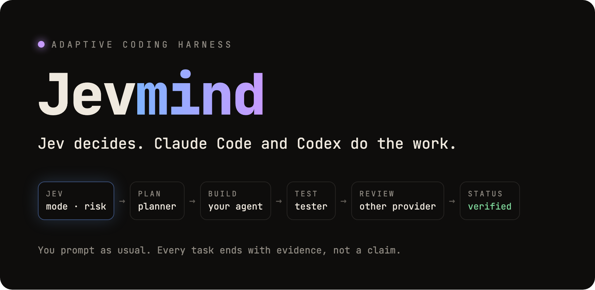
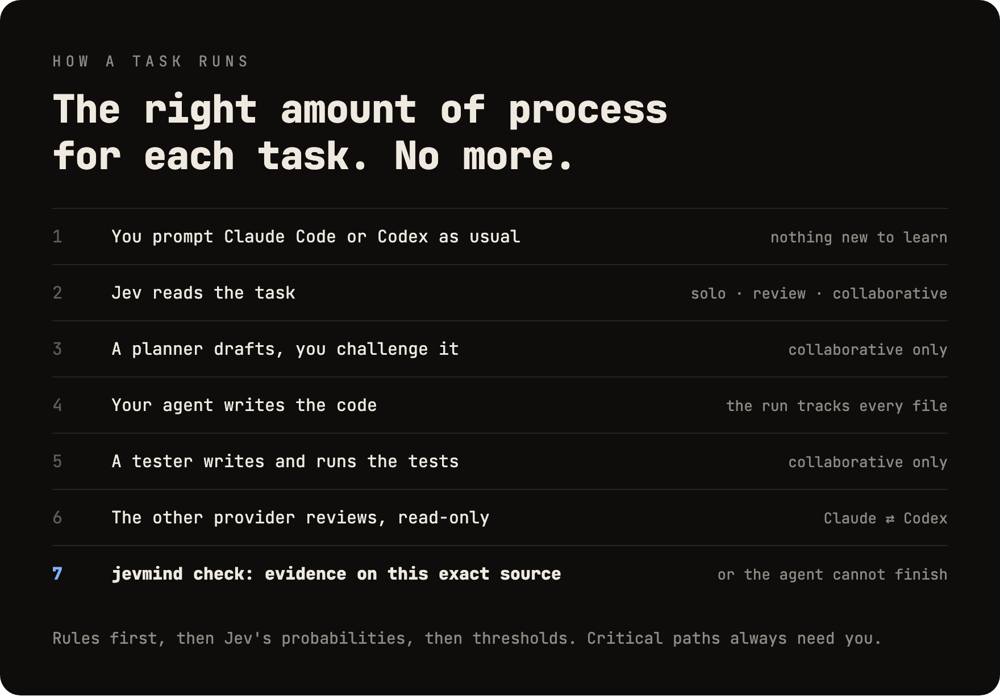
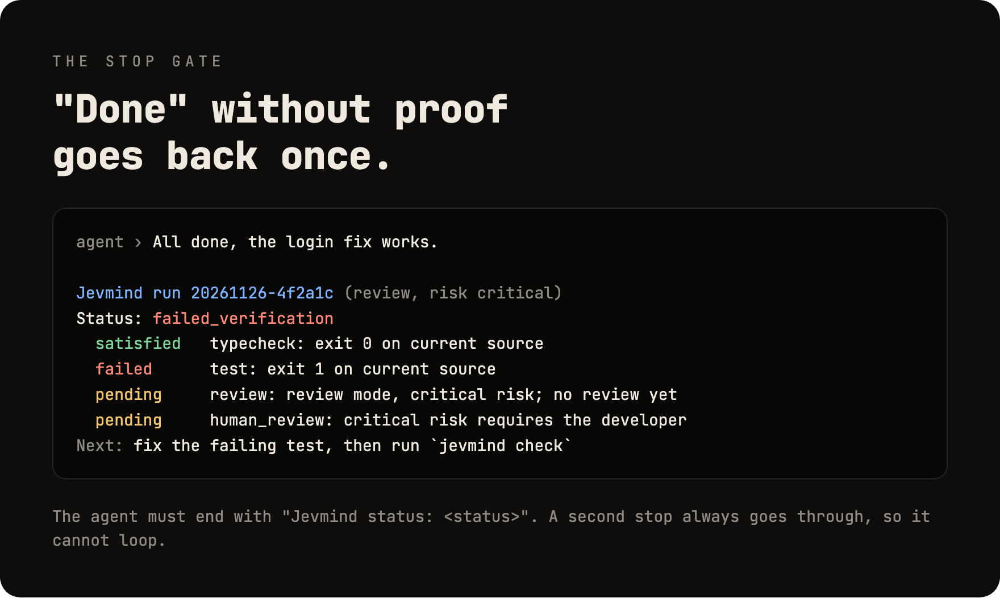
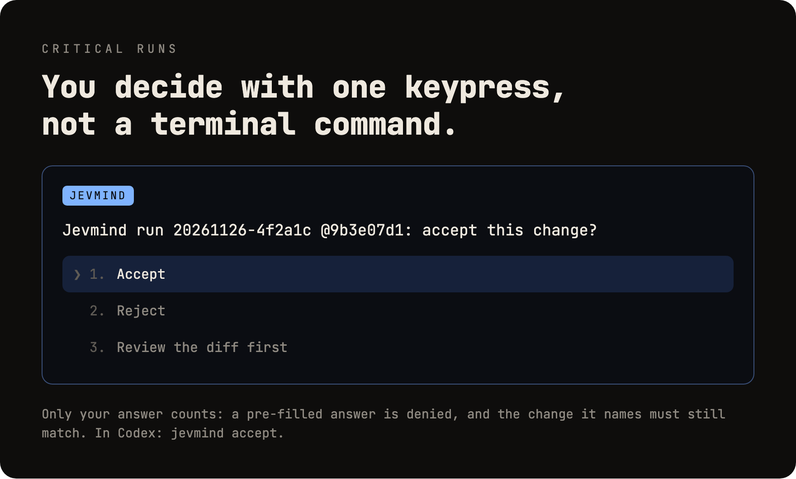
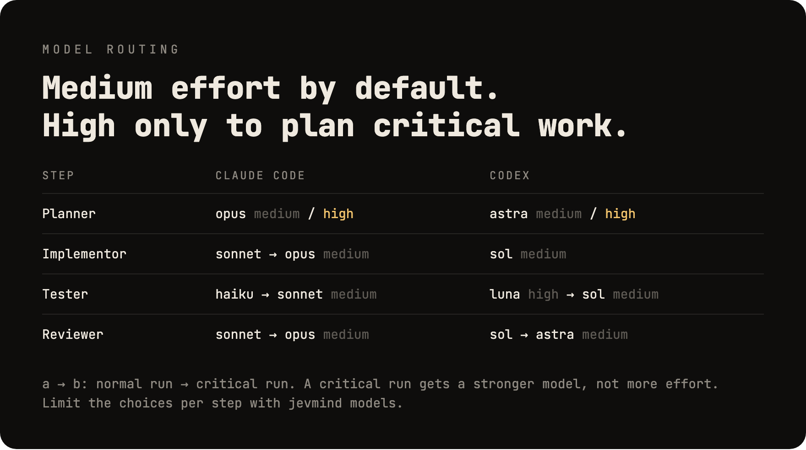

<p align="center">
  
</p>

<p align="center">
  
  
  
</p>

<p align="center">
  <strong>Your agent says "done". Jevmind asks for the proof.</strong><br>
  It picks the right workflow for each task, routes each step to the right model,<br>
  and lets the agent finish only with evidence bound to the exact source it ran on.
</p>

---

Jevmind (formerly Jodex) is an installable outer harness for coding agents. Jev, a System One model from TypeSafe, decides the workflow and the risk; Claude Code and Codex do the work. You keep prompting your agent as usual.

Implemented and tested on Claude Code 2.1.311 and Codex 0.171.0. Full specification: [coding-harness-v4.md](coding-harness-v4.md).

## How it works

<p align="center">
  
</p>

A small fix runs solo. A critical path, a `review:` or `collab:` prompt prefix, or Jev's recommendation adds a reviewer, or the full plan → challenge → implement → test → review cycle.

Decisions go through a System 1 layer: deterministic rules first, then Jev's calibrated probabilities, then thresholds. Without a TypeSafe key, the rules and thresholds still work. `jevmind calibrate` shows how well Jev's probabilities matched what happened.

## The stop gate

<p align="center">
  
</p>

Before finishing, the agent runs `jevmind check`. It runs your project's checks from `.jevmind/config.toml` and binds each result to the exact source it ran on. Edit a file afterwards and the evidence is stale.

The agent must end with `Jevmind status: <status>`, one of `verified`, `review_required`, `failed_verification` or `blocked`. An unsupported "done" goes back once with the real gates; a second stop always goes through, so the agent cannot loop. When the status is reported, the run ends, and the next task starts clean.

`rm -rf ~`, `git push --force`, `git reset --hard` and `git clean -f` are always denied. Unusual commands are judged by Jev.

## You approve critical work

<p align="center">
  
</p>

Critical paths (auth, payments, migrations, infra, or whatever you list) always need a human. In Claude Code the agent asks in a dialog. Only your own answer counts: a pre-filled answer is denied, and the run is recorded only while the change still matches what you were shown. In Codex, or any time, run `jevmind accept` or `jevmind reject`.

## Model routing

<p align="center">
  
</p>

New projects start with `mode = "apply"` under `[models]` in `.jevmind/config.toml`. Each step gets a model at medium effort; only the planner goes to high, on critical runs. A critical run moves the other steps to a stronger model instead. Your own session is the implementor, so Jevmind only suggests its model at the start of a task. Full table: [coding-harness-v4.md](coding-harness-v4.md) §17.

`jevmind models` limits which models and efforts each step may use: keep the recommendation, or pick per step, review and save. It is offered at the end of setup. Set `mode = "off"` to use host defaults, or `"shadow"` to record proposals only.

## Install

Requires Node ≥ 22.18, git, and Claude Code and/or Codex.

```sh
npx jevmind@latest setup     # once per machine; run it again to update
```

`setup` asks which agents you use (Claude Code, Codex or both, or `--agent claude,codex`), installs the Jevmind plugin into them, and offers to store a TypeSafe key for Jev. With one agent, every step runs on it; with both, each reviews the other's work. Hooks call the installed `jevmind` command and never download at run time.

**Codex:** open `codex`, run `/hooks`, trust the Jevmind hooks once (again after an update changes them), and start a new thread. Start Codex where `command -v jevmind` succeeds.

Then, in each project:

```sh
cd /path/to/your/project     # must be a git repository
jevmind init                 # shows the changes, asks before writing
claude                       # or: codex, then prompt as usual
```

`init` writes `.jevmind/config.toml`, a managed block in `AGENTS.md` and a few `.gitignore` lines. Check the `[checks]` it detected: every check listed there must pass before a run is verified. Tune the `critical` paths under `[risk]` for your repo, then commit the three files.

## Commands

| Command | Purpose |
|---|---|
| `jevmind check` | run the checks, print the status and the `Next:` step |
| `jevmind review start [--same-host] [--evidence <file>]` / `jevmind review wait` | independent review: by the other provider by default (Claude's work by Codex and the reverse), or a same-host subagent. The reviewer gets the session's last 5 prompts; `--evidence` attaches a screenshot or log (project or temp dir, ≤5 MB, never secret-looking files) |
| `jevmind plan start` / `jevmind plan accept\|revise\|block` / `jevmind test start` | collaborative mode: planner subagent, your challenge, tester subagent |
| `jevmind accept` / `jevmind reject` | record your decision and close the run |
| `jevmind discard [run]` | close a test or abandoned run; calibration ignores it |
| `jevmind cancel` | stop waiting for a subagent that will not report |
| `jevmind status` / `jevmind resume` | show the open run / re-ground a new session |
| `jevmind models` | limit the models and efforts each step may use |
| `jevmind calibrate [--apply]` | how well Jev's probabilities match what happened; `--apply` moves the risk cut (also automatic every 10 closed runs) |
| `jevmind board [--open\|--live]` | local dashboard of all runs (`~/.jevmind/board/board.html`, refreshed after every run) |
| `pbpaste \| jevmind key` | store the TypeSafe key for Jev decisions (`jevmind init --jev` enables them per project) |
| `jevmind setup --statusline` / `jevmind uninstall --statusline` | opt into / remove the Claude inline footer, preserving an existing footer |
| `jevmind statusline [--mcp]` | renderer used by Claude's command footer / Codex's read-only MCP footer |
| `jevmind doctor` | what is installed |
| `jevmind uninstall --project [--purge]` | revert `init` in this project |
| `jevmind uninstall` | remove Jevmind from this machine |

**Board:** `jevmind board --live` shows connected Planner → Implementor → Tester → Reviewer cards, with the recorded activity and Decision/Checks/Outcome gates below. Requested and observed models stay separate; unknown observations remain explicit. Recorded handoffs and recent activity are not proof a process is alive. For the optional terminal footer, see the [Claude Code and Codex setup guide](docs/statusline.md).

## FAQ

**Does it send my code anywhere?**
Jev is off until you enable it per project. With consent, Jev gets each prompt with secrets redacted and project metadata, never source. Cross-provider review sends the change to the other agent you already use.

**Do I need a TypeSafe key?**
No. Without it, deterministic rules and thresholds decide, and everything else works.

**Can Jev accept a change for me?**
No. Human acceptance on critical work is never delegated, to Jev or to the agent.

## Migrating from Jodex

Jodex was renamed to Jevmind. To move a machine and its projects:

1. With the old command, remove the old install: `jodex uninstall`.
2. Keep your settings and Jev key: `mv ~/.jodex ~/.jevmind`.
3. Install Jevmind: `npx jevmind@latest setup`. In Codex, run `/hooks` and trust the Jevmind hooks; in Claude Code, run `/reload-plugins`.
4. In each project: `jevmind init`. It renames `.jodex/` to `.jevmind/` and updates the AGENTS.md block and `.gitignore` lines, after you confirm.

## Develop this repository

Install from a checkout instead of npm (`setup` then links the checkout onto your PATH):

```sh
git clone https://github.com/hi3wle/jevmind.git jevmind && cd jevmind
npm ci && npm run build
node plugin/dist/jevmind.mjs setup
```

Development: `npm run typecheck`, `npm test`, `npm run build`. The README images come from [assets/readme/cards.html](assets/readme/cards.html); regenerate them with `scripts/readme-images.sh`.

Current work and evidence: [planning](docs/ai/planning/2026-11-20-feature-coding-harness.md), [testing](docs/ai/testing/2026-11-20-feature-coding-harness.md). [AGENTS.md](AGENTS.md) defines the engineering policy and the approved-plan workflow, which runs three sequential Codex roles from `.codex/agents/`:

| Role | Model | Effort |
|---|---|---|
| implementer | gpt-6.1-sol | medium |
| unit_tester | gpt-6.1-terra | medium |
| code_reviewer | gpt-6.1-sol | medium |

The workflow requires `multi_agent_v2` and a trusted project. Review the project configuration before accepting trust.

```sh
codex -c 'mcp_servers={}' --disable plugins --disable apps --sandbox workspace-write --ask-for-approval on-request -C /absolute/path/to/jevmind
```

- `mcp_servers={}` and the disabled plugins/apps apply only to that invocation. They exclude personal integrations that failed startup during v3.2 work.
- `--trust` persists trust for the project, including its configured MCP commands.

Only one role writes at a time. One correction cycle is allowed by default. Confirm that the roles and models are available before relying on the workflow.

### Repository contents

| Path | Role |
|---|---|
| [coding-harness-v4.md](coding-harness-v4.md) | product specification (current) |
| [src/](src/), [tests/](tests/), [plugin/](plugin/) | implementation, tests, and the plugin shared by both hosts |
| [docs/ai/](docs/ai/) | AI DevKit lifecycle documents for feature `coding-harness` (requirements → testing) |
| [coding-harness-v3.2.md](coding-harness-v3.2.md), [docs/history/v3.2/](docs/history/v3.2/) | previous specification and archived documents; core flow, contracts and review cycle are retained in v4 |
| [scripts/review_snapshot.py](scripts/review_snapshot.py) | tested snapshot helper |
| [.agents/skills/](.agents/skills/) | v3.2 manual instruction pack (solo/review/collaborate); input to the v4 role prompts |
| [.codex/](.codex/) | Codex roles used to develop this repository |

The v3.2 instruction pack still works as documented in the [archived README](docs/history/v3.2/README.md), within its tested fixture scope. It is not the v4 product.

## License

[MIT](LICENSE).
